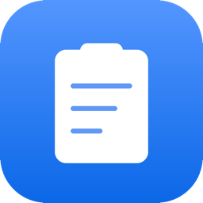
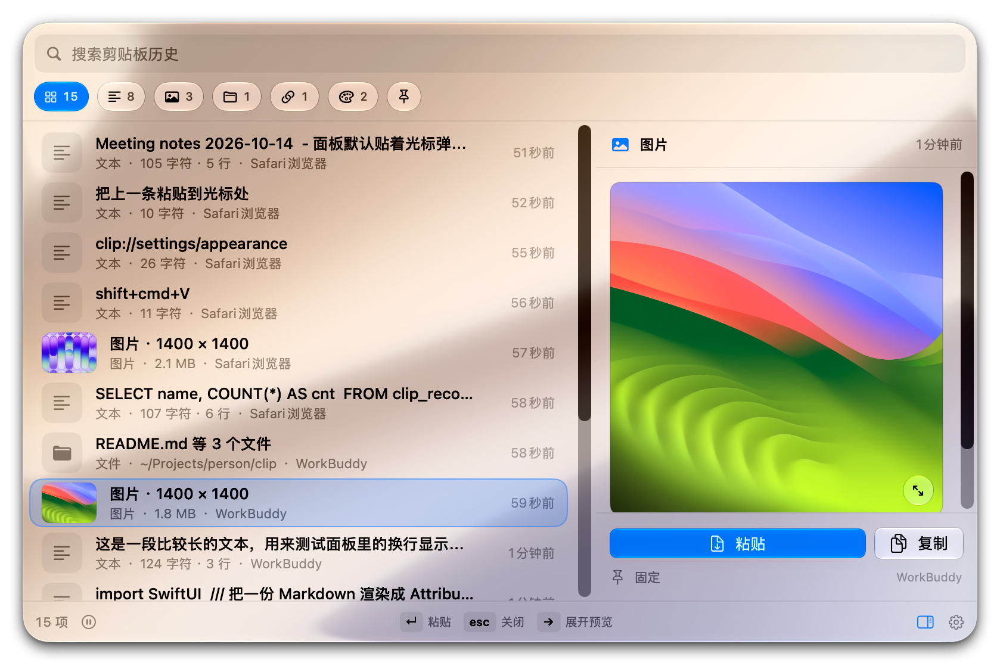
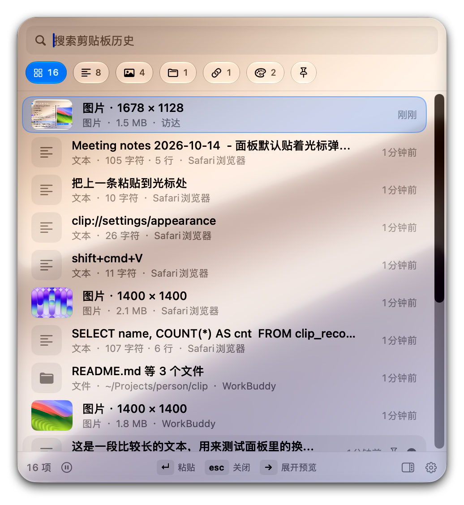
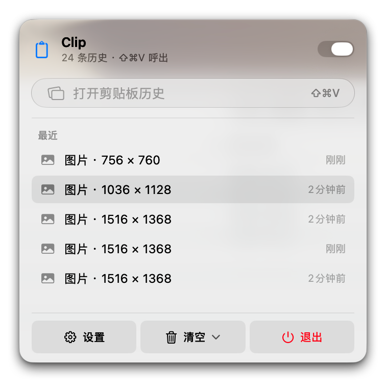
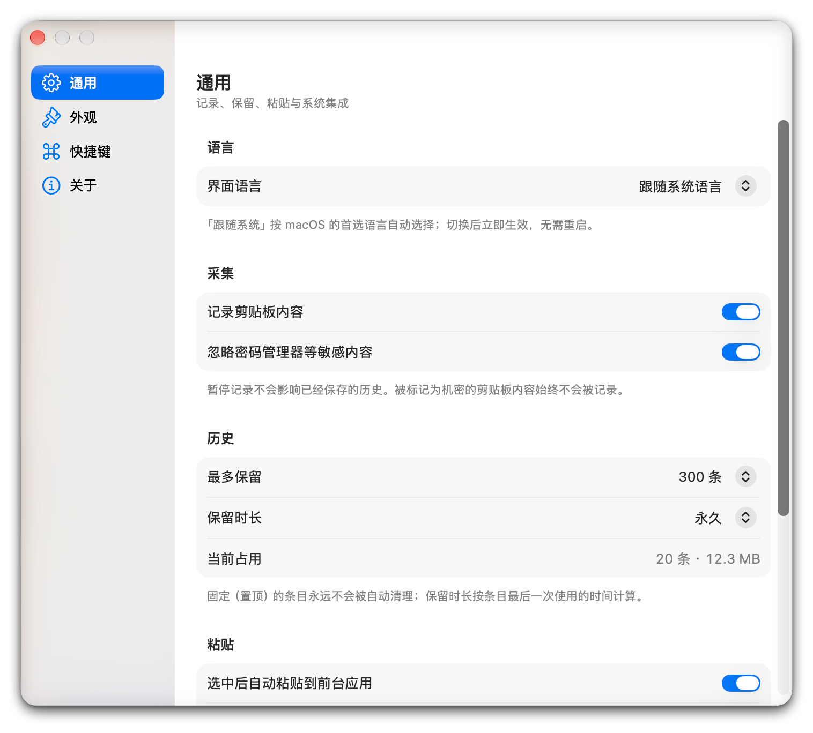
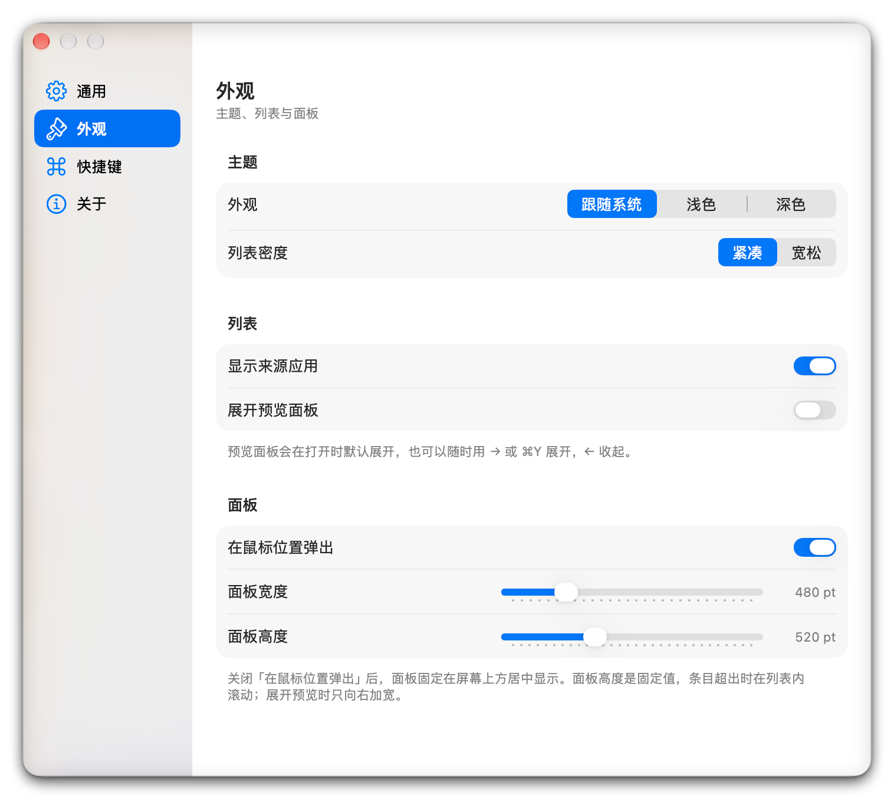

<div align="center">
  
  <h1>Clip</h1>
  <p><b>macOS のクリップボード履歴マネージャー</b><br>ショートカットを押すだけで、履歴がその手前に現れます。</p>
</div>

<p align="center">
  <a href="README.md">简体中文</a> ·
  <b>English</b> ·
  <a href="README_ja.md">日本語</a> ·
  <a href="README_fr.md">Français</a>
</p>

<div align="center">
  
</div>

---

## 何が解決されるか

コードコピー→ドキュメント確認中に別の作業をしてしまい、さっきコピーした内容を戻って貼ろうとしたら、クリップボードにはもう別のものが入っています。

Clip はコピーした内容をバックグラウンドで静かに記録しておきます。<kbd>⇧⌘V</kbd> でいつでも呼び出し、矢印キーで選び、<kbd>↵</kbd> でカーソル位置に直接貼り付けられます。

<p align="center">
  
</p>

常駐ウィンドウもタブも不要。「どこに保存したっけ」と考える必要もありません。履歴は目の前に摊，曾经一度ة，只需要スクロールして選ぶだけです。

## 主な機能

### すべてを覚えておく

テキスト、リンク、色値、コード、ファイルパス、画像 —— コピーしたものはすべて記録し、どのアプリから来たかをタグ付けして保存します。

<p align="center">
  
</p>

上部のピル状のボタンで種類ごとに絞り込め、件数がリアルタイムで表示されます。スクリーンショット、デザイン稿、コピーした色値 —— それぞれがちゃんと自分の場所に収まり、混ざり合いません。

### 呼んだら即使える

- **カーソルのそばに出現** —— マウスの位置にそのまま表示。画面の端で収まらない場合は自動的に反対側へ
- **高さは固定** —— 項目が何件あってもリストの中だけがスクロールするため、呼び出した瞬間にウィンドウが上下に揺れません
- **Enter で即貼り付け** —— カーソル位置に直接貼り付けられるので、前のアプリに手動で戻す必要がありません

### 見てから決められる

項目を選んで <kbd>→</kbd> を押すと、右側にプレビューが広がります。**左上隅は固定**されるので、読んでいたリストが横にずれることはありません。画像をクリックするとスクリーンサイズまで拡大して確認でき、任意の場所をクリックするか `esc` で閉じます。

### キーボードだけで操作

| キー | 動作 |
| --- | --- |
| <kbd>⇧⌘V</kbd> | 表示 / 非表示（任意のショートカットに変更可能） |
| <kbd>↑</kbd> <kbd>↓</kbd> | 選択を移動 |
| <kbd>↵</kbd> | カーソル位置に貼り付け |
| <kbd>⌥↵</kbd> | 書式なしのプレーンテキストとして貼り付け |
| <kbd>→</kbd> <kbd>←</kbd> | プレビューを展開 / 折りたたむ |
| <kbd>⌘1</kbd>–<kbd>⌘9</kbd> | n 番目の項目をそのまま貼り付け |
| <kbd>⌘P</kbd> | ピン留め / 解除 |
| <kbd>⌘⌫</kbd> | 選択中の項目を削除 |
| <kbd>esc</kbd> | パネルを閉じる |

### メニューバーからも操作可能

ショートカットを使わない場合も、ステータスバーのアイコンをクリックすれば同じことができます。記録の ON / OFF、最近の項目の確認、メニューバーから直接貼り付け —— すべてここでできます。

<p align="center">
  
</p>

### デスクトップにも

通知センター / デスクトップウィジェットに最近の履歴が表示されます。クリックすればコピーされ、空所をクリックすれば全パネルが呼び出されます。

### 探している項目を見つける

上部の検索ボックスに入力するとリアルタイムで絞り込めます。ピン留め（<kbd>⌘P</kbd>）した項目は自動整理の対象にならないので、パラメータや URL など、よく使うスニペットを手元に置いておけます。

## インストール

**macOS 27（Golden Gate）以降**が必要です。

[Releases](https://github.com/wrm244/clip/releases) から `.dmg` をダウンロードし、アプリケーションフォルダにドラッグしてください。

初回起動後、メニューバーにクリップボードアイコンが現れます。Clip に <kbd>⌘V</kbd> を押させるには、**システム設定 → プライバシーとセキュリティ → アクセシビリティ** で Clip を有効にしてください。権限がなくても動作しますが、クリップボードにコピーして手動で貼り付けるよう促す動作になります。

## プライバシー

クリップボードマネージャーはコピーした内容をすべて見为代表ます。その点は率直にお伝えします。

- **機密コンテンツは初期設定で無視** —— パスワードマネージャー（1Password、TypeIt4me など）が機密と指定したクリップボード内容は記録されません
- ** 자신이書き戻した内容は記録しない** —— 履歴を自分自身に二重にコピーすることはありません
- **いつでも一時停止可能** —— ワンスイッチで記録を停止できます
- **データはこの Mac の中だけ** —— 履歴は `~/Library/Application Support/Clip` に保存されます。アップロードも同期も、アカウントも一切不要です
- **上限を設定できる** —— 項目数（初期値は 300）と保存 기간を自由に設定でき、全データの消去もワンクリックで可能です

## ライセンス

[MIT](LICENSE) ライセンスのもとで公開しています。自由に使用・改変・再配布できます。

## すべての設定

**一般** —— 言語、記録の ON / OFF、機密コンテンツの無視、項目数と保存期間、自動的に貼り付けるかどうか。

<p align="center">
  
</p>

**外観** —— ライト / ダーク、リストの密度、取得元アプリの表示、パネルの大きさ、カーソル脇に表示するか画面上部中央にするか。

<p align="center">
  
</p>

**ショートカット** —— グローバルショートカットの変更と、パネル内で使えるすべてのショートカットの確認。

すべての変更は**すぐに反映**されます。「適用」ボタンは必要で、再起動も不要です。

## 対応環境

- 中国語 / 英語の表示。設定から切り替えでき、既定ではシステムの言語に従います
- ライト / ダーク外観。システムに従うか手動で指定
- ログイン時に自動起動
- 「透明度を低下」「コントラストを増加」「視差効果を減らす」などのシステムアクセシビリティ設定に対応

---

<details>
<summary><b>開発者向け情報（ビルド · アーキテクチャ · 実装の詳細）</b></summary>

### 技術スタック

ネイティブな SwiftUI + AppKit、**サードパーティ依存ゼロ**。メニューバーエージェント（`LSUIElement`）として常駐し、Dock を占しません。SwiftData で差分永続化を行い、画像などのバイナリデータは外部ファイルとして保存します。

- 対象: macOS 27.0+、Swift 6（strict concurrency）
- UI は [Apple ヒューマンインターフェースガイドライン](https://developer.apple.com/design/human-interface-guidelines/)に従い、システムのネイティブ Liquid Glass を使用
- 署名: 自己署名証明書 `Clip Self Signed`。アクセシビリティの認可がバージョンをまたいで保持されます（理由は以下）

### ビルド

[XcodeGen](https://github.com/yonaskolb/XcodeGen)（`brew install xcodegen`）が必要です。

```bash
xcodegen generate                       # project.yml から Clip.xcodeproj を生成
open Clip.xcodeproj                     # Xcode から Run
```

コマンドラインでのビルド:

```bash
export DEVELOPER_DIR=/Applications/Xcode.app/Contents/Developer
xcodebuild -project Clip.xcodeproj -scheme Clip \
  -configuration Release -destination 'platform=macOS,arch=arm64' \
  -derivedDataPath build build
```

成果物: `build/Build/Products/Release/Clip.app`

> ソースファイルを追加・削除したあとは `xcodegen generate` を再実行してください（プロジェクトはディレクトリ単位で収集します）。
> ディスク上に Clip.app を複数置かないでください（Debug と Release を併置すると同様）。データディレクトリを共有しており、
> 起動時に別のコピーを検出して Side を譲ります。

### パッケージングとリリース

```bash
Scripts/make-dmg.sh build/Build/Products/Release/Clip.app dist v1.0.6
```

`.github/workflows/release.yml` が `v*` タグの push でビルド・パッケージ・アップロードを自動実行します。
CI の署名には 2 つの Secret が必要です: `P12_BASE64`（p12 の 1 行 base64）と `P12_PASSWORD`。

### なぜ ad-hoc 署名を使わないのか

ad-hoc 署名には安定した識別子がなく、macOS がプライバシー認可（TCC、たとえばアクセシビリティ）に記録する指定要件は
`cdhash H"…"` —— バイナリ全体のハッシュしか書けません。再ビルドのたびに cdhash が変わって認可が失効し、
ユーザーが更新のたびに再認証が必要になります。

自己署名証明書を使うと指定要件は `identifier "com.river.Clip" and certificate leaf = H"…"` となり、
バンドル ID と証明書にだけ紐づくため、バイナリがどう変わっても認可が保持されます。

証明書は一度だけ作成します: キーチェーンアクセス → 証明書アシスタント → 証明書の作成…、
名前を `Clip Self Signed`、書類の種類は「自己署名ルート」、証明書の種類は「コード署名」で、
「常に信頼」に設定します。

> **p12 には証明書と秘密鍵の両方が必要です。** 秘密鍵だけをエクスポートすると、インポートは成功しても identity が構成されません。
> `security export -t identities` で identity 全体をエクスポートすれば避けられます。

### アーキテクチャの要点

**取得パイプライン**: `NSPasteboard.general.changeCount` を 0.4 秒ごとにポーリング（`Timer` + `tolerance` 0.2、CPU への影響はきわめて小さい）→ 変化時に `ClipDraft` として解析 → 重複排除 / 変換 / 保存 → SwiftData に差分書き込み。
パネルを開いているとフォ找到一个アプリが Clip 自身になるため、この場合は破棄せず遅延再試行し、取得漏れを防ぎます。

**並行モデル**: `SWIFT_DEFAULT_ACTOR_ISOLATION=MainActor` + `SWIFT_STRICT_CONCURRENCY=complete`。
UI と状態はメインアクター、データベース / ファイル I/O と画像変換は `ClipStorage` と `ImageTranscoder` の 2 つのアクターに隔離し、
メidthreads は I/O に触れません。

SwiftData における重要な判断: `@Model` クラスは明示的に `nonisolated`、`ModelContext` はアクターのメソッド内で遅延生成（初回アクセスがメインキューに落ちるのを避ける）、
`@Model` のインスタンスはアクターをまたいで渡さず、外部には Sendable な `ClipItem` DTO のみを公開、autosave は無効化し書き込みごとに明示的に `save()` を呼ぶ（強制終了時 autosave は信頼できない）、
スキーマは `VersionedSchema` + `SchemaMigrationPlan` で開始。

**ウィンドウ**: `NSPanel(.borderless, .fullSizeContentView, .nonactivatingPanel)`、`canBecomeKey = true` で検索入力に対応、`level = .floating`。
プレビュー展開時はウィンドウを右へ広げるだけで、左上隅を固定したまま位置を再計算しません。

**ホットキー**: Carbon の `RegisterEventHotKey`、C コールバック内で `MainActor.assumeIsolated` を使ってメインアクターに戻ります。
`CGEventTap` と異なりアクセシビリティ権限は不要です。

**ループ防止**: クリップボードへの書き戻し時に `com.river.clip.marker` タイプを付け、ポーリング時にそれをスキップします。

**メニューバーパネル**: macOS 27 の `NSStatusItem`「展開インターフェース」セッション（`NSStatusItemExpandedInterfaceDelegate`）を `NSPopover` の代わりに使用。
システムセッションがキーボードナビゲーションとメニュー追跡を_QUEUE 処理します。3 つの硬い制約があります:
`menu` を設定しない、target/action で手動トグルしない、閉じるには `expandedInterfaceSession?.cancel()` を呼ぶ。

**データの保存場所**:

```
~/Library/Application Support/Clip/
├── Clip.store      SwiftData データベース（内部は SQLite）
├── Blobs/          PNG 原画、JPG サムネイル、RTF リッチテキスト
└── Widget/         デスクトップウィジェット用の読み取り専用スナップショット（feed.json + Thumbs/）
```

設定は `~/Library/Preferences/com.river.Clip.plist` に保存されます。

### ディレクトリ構成

```
project.yml                 XcodeGen のプロジェクト定義
Support/Info.plist          LSUIElement、clip:// URL スキーム
Sources/
  App/                      エントリポイント、ライフサイクル、アプリ全体の協調
  Models/                   項目モデル、設定、ショートカット
  Services/                 取得、解析、変換、保存、ホットキー、貼り付け
  UI/                       パネル、プレビュー、メニューバーパネル、設定ウィンドウ
  Support/                  ローカライズ、ログ、ウィジェットフィード
Widget/                     デスクトップウィジェット（読み取り専用スナップショット方式）
Scripts/                    make-dmg.sh、seed-clipboard.swift
```

`Scripts/seed-clipboard.swift` は開発用の補助ツールです。JSON のマニフェストに従ってシステムクリップボードへ一連の書き込みを行い、
各種のテストデータをすばやく生成できます。

```bash
swiftc -O Scripts/seed-clipboard.swift -o /tmp/clipseed
/tmp/clipseed run Scripts/seed-content.sample.json 1100
```

### 既知の制限

- 「ログイン時に起動」は `SMAppService.mainApp` を使用します。アプリが `/Applications` にない場合は失敗することがあります（設定画面にエラーが表示されます）
- 画像の初期上限は 8MB（超過分はダウンサンプリング）、履歴は初期値で 300 件、ピン留めした項目は自動整理されません
- デスクトップウィジェットは `temporary-exception.files.home-relative-path.read-only` でメインアプリのスナップショットディレクトリを読み込みます。
  App Group を持たないビルドで唯一使える共有経路です。Mac App Store で公開する場合は App Group と正式な署名が必要です
- ウィジェットのスナップショットには直近 12 件の履歴のタイトルが含まれます（現在無効化できません）
- 自己署名証明書で署名しています。Mac App Store への配布や Apple の notarization には Developer ID 証明書が必要です

</details>

<p align="center">
  <sub>Pure SwiftUI + AppKit · サードパーティ依存ゼロ · データはこの Mac の中だけ</sub>
</p>